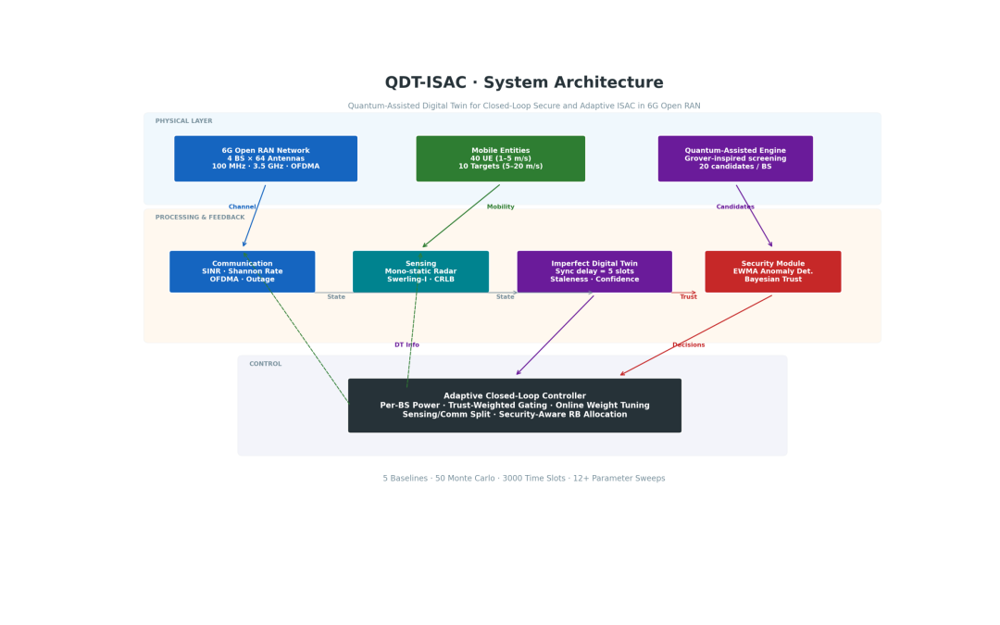
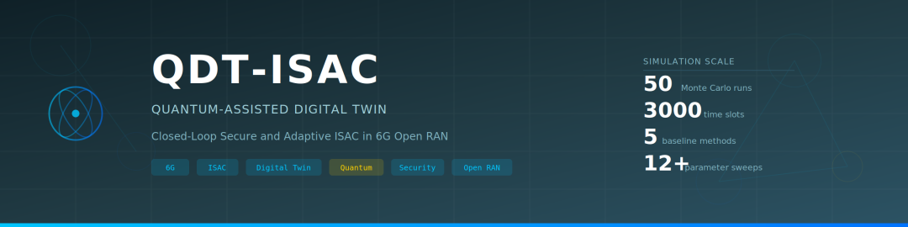
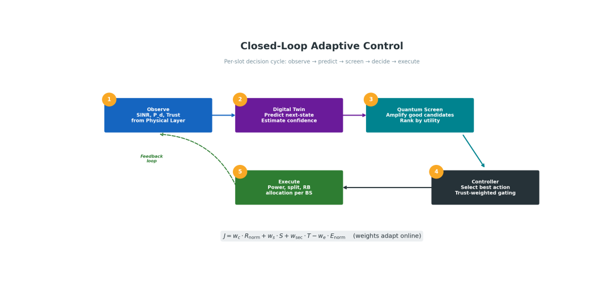
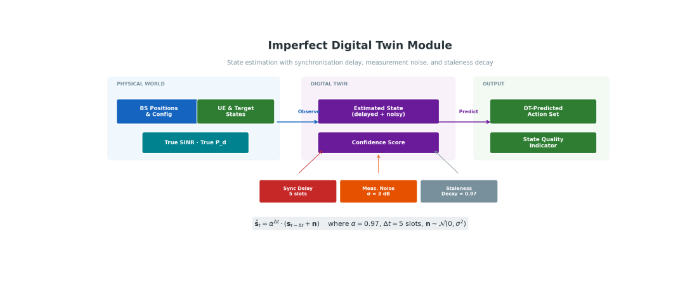
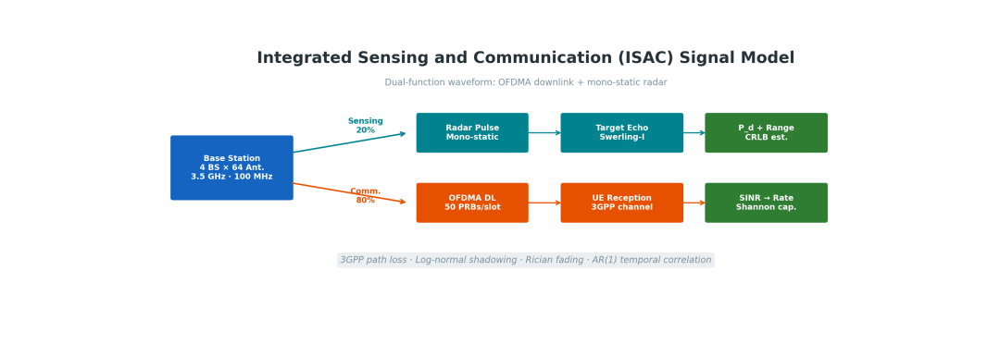
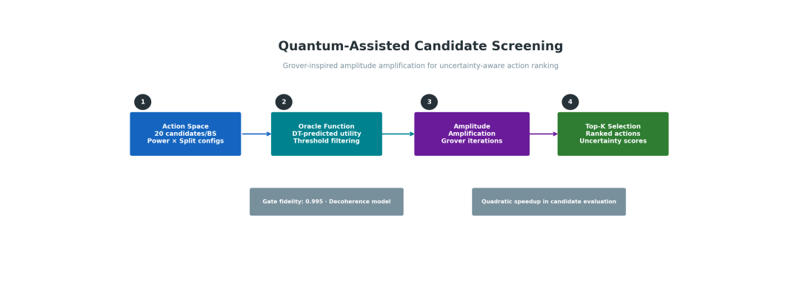
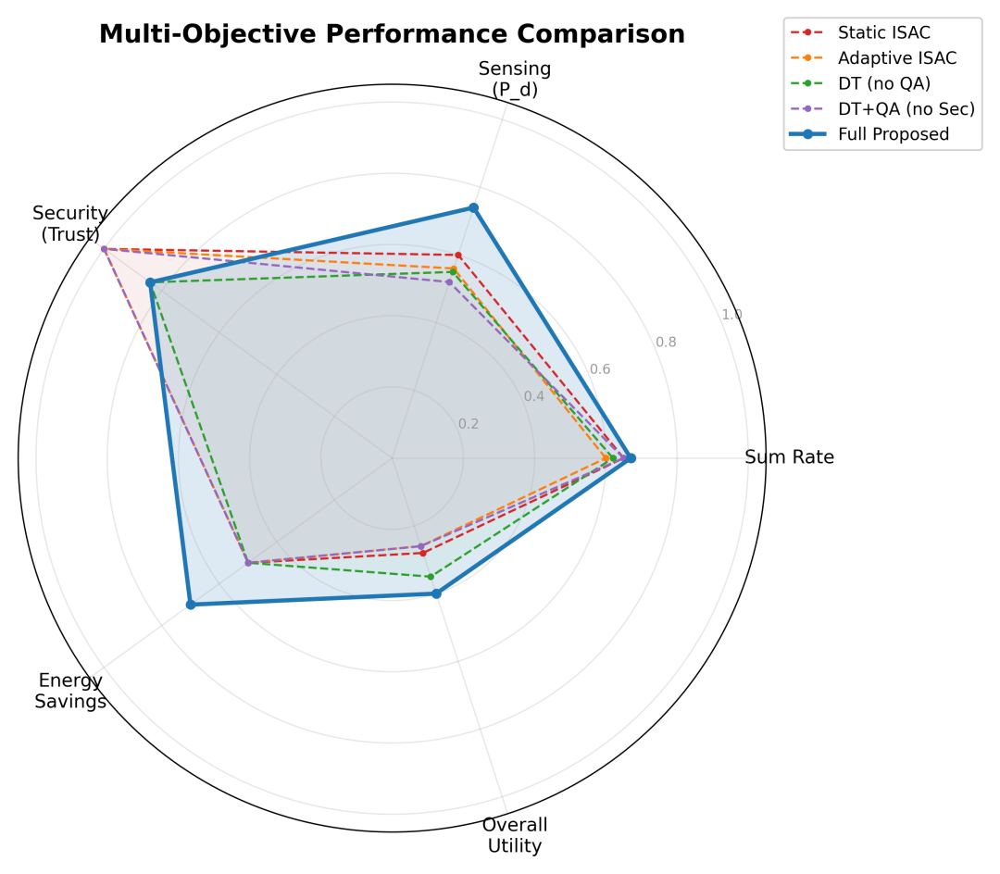
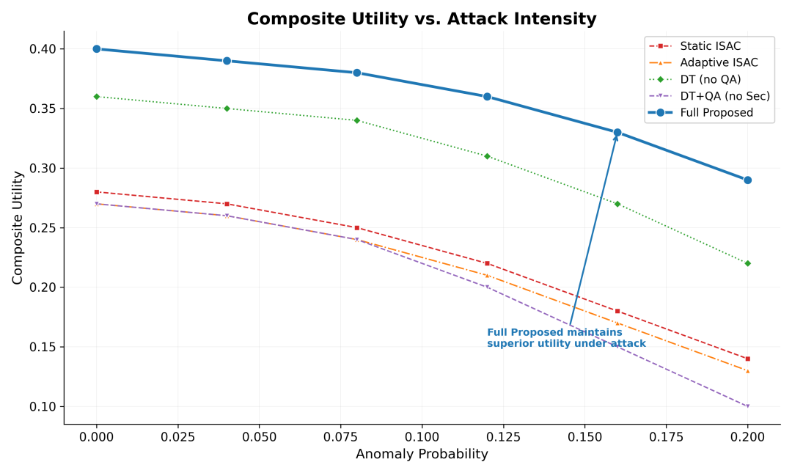
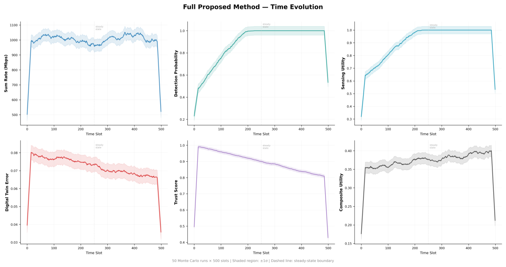

# ISAC: New Breakthrough in 6G Open RAN with Quantum-Assisted Digital Twins! Enhancing Communication Sensing Integrity and Intelligence

6G Open RAN New Breakthrough! Quantum-Assisted Digital Twins for More Safe and Intelligent Communications in the Age of 6G
In the era of 6G, the deep integration of communication and perception (ISAC) has become a core capability for wireless systems. The flexible orchestration features of open radio access networks (Open RAN) pose multiple challenges to the adaptive and secure operation of ISAC. Recently, an advanced study proposed a quantum-assisted digital twin framework, providing a novel solution for closed-loop secure adaptive ISAC in 6G Open RAN.
1. Core Information Paper Title: Quantum-Assisted Digital Twins for Closed-Loop Secure Adaptive Communication and Perception Integrated in 6G Open Radio Access Networks
Abstract
The integrated communication and perception (ISAC) is expected to become the foundational capability of 6G wireless systems, especially in environments characterized by flexible orchestration, programmability, and business perception requirements for open radio access networks (Open RAN). However, in such environments, strong coupling between communication and perception objectives, high dynamicity of wireless and environmental states, and the vulnerability of distributed software control loops to information-physical inconsistencies still present challenges for the safe and adaptive operation of ISAC.
This paper proposes a quantum-assisted digital twin framework for closed-loop secure adaptive ISAC in 6G Open RAN. This architecture continuously updates the digital twins of communication, perception, and trust status in the physical network, guiding the deployment of adaptive resource allocation and robust perception strategies. The research constructs an utility-driven joint control model that balances communication performance, perception efficiency, trust perception security, and energy efficiency; it introduces a quantum-inspired candidate filtering module to reduce search complexity while integrating a security perception trust mechanism to identify divergence and suppress unreliable operations.
Through simulation framework validation, the results show that this framework outperforms baselines in terms of communication-perception-security trade-off, achieving the highest overall utility, optimal detection performance, and lowest energy consumption, providing a viable direction for future secure intelligent ISAC orchestration in 6G Open RAN.
II. Introduction: Challenges and Breakthrough Directions for 6G ISAC
The 6G wireless network integrates communication, perception, intelligence, and automation into a unified programmable infrastructure. Integrated Communication and Perception (ISAC) due to its ability to share spectrum, waveforms, and hardware resources, has become a research hotspot, especially adapting to the decoupling, software-defined control, and intelligent orchestration features of Open RAN.
However, in the context of Open RAN, there are three core challenges to secure and adaptive ISAC:
1. The strong coupling and mutual competition between communication and perception objectives make it difficult to balance the efficiency of both sides;
2. Mobileness, fading, blocking, and other factors lead to high dynamic system states;
3. Distributed software control loops can easily experience delays, inconsistencies, and are vulnerable to information-physical attacks.
Traditional open-loop optimization and static strategies cannot meet these needs anymore. Digital twins can create virtual replicas of physical networks, integrating telemetry data, predictive states, and pre-evaluation operations, becoming a key breakthrough. However, existing digital twins struggle to simultaneously accommodate ISAC's communication, perception, and security requirements, and they cannot handle issues such as synchronization delay and observation noise.
Based on this, this study proposes a quantum-assisted digital twin framework that does not rely on a fully quantum native network but uses quantum-inspired modules to accelerate decision-making and filter control decisions. Coupled with a trust-aware mechanism, it achieves secure adaptive control.
III. Methodology Overview: Four Core Modules to Build a Closed-Loop Control System
1. Unified Architecture Design: Build a closed-loop architecture that integrates communication, perception, trust, and control states. Deploy four base stations, 40 users, and 10 perception targets within a 1km² service area, each equipped with 64 antennas, supporting OFDM communication and single static perception.
2. Multi-Objective Optimization Model
Focusing on maximizing comprehensive utility, balancing communication rate, perception efficiency, trust security, and energy consumption while constraining bandwidth, power, and perception detection probability, solving non-convex optimization problems.
3. After generating a candidate operation set by the quantum-inspired candidate selection controller, it is sorted through the quantum-inspired filtering module, combining twin states, trust states, and utility expectations to reduce the complexity of high-dimensional search.
4. Trust perception security deployment calculates trust scores based on anomaly evidence, observation consistency, and twin reliability. It employs EWMA anomaly detection and Bayesian trust update. When the trust value falls below a threshold, it adopts a conservative deployment strategy to suppress unsafe operations.
5. Simulation verification design and construct a discrete-time simulation framework to simulate real scenarios such as time-varying channels, mobility, twin synchronization delay, and anomaly injection. Set up five sets of baselines to verify the performance of the framework.
IV. Conclusion: Quantum-Assisted + Digital Twin, Reshaping the ISAC Control Paradigm of 6G
Experimental results confirm:
1  
This framework has superior comprehensive utility, perceptual detection performance and lowest energy consumption compared to all the baselines.
2  
Digital twins directly participate in the control loop, rather than passively mirroring, can significantly enhance strategy quality.
3  
Quantum-assisted screening requires the integration of trust perception deployment to achieve optimal efficacy.
4  
The framework maintains robust performance under scenarios such as exceptional attacks and twin latency, adapting to practical deployment needs.
This study provides a new technical path for the integrated orchestration of secure and intelligent communication perception in 6G Open RAN, which will be expanded to more diverse business types and larger scale verifications in the future to further refine the technology system.

## Images

<!-- PAYMENT_BLOCK -->

## Get this dataset

- Payment link (Stripe): [Buy now](https://buy.stripe.com/3cs8yP7sY87d0vu9AB)
- Payment QR code: 

<!-- /PAYMENT_BLOCK -->
